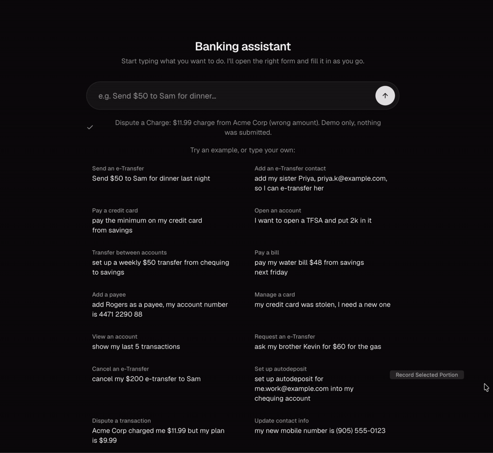
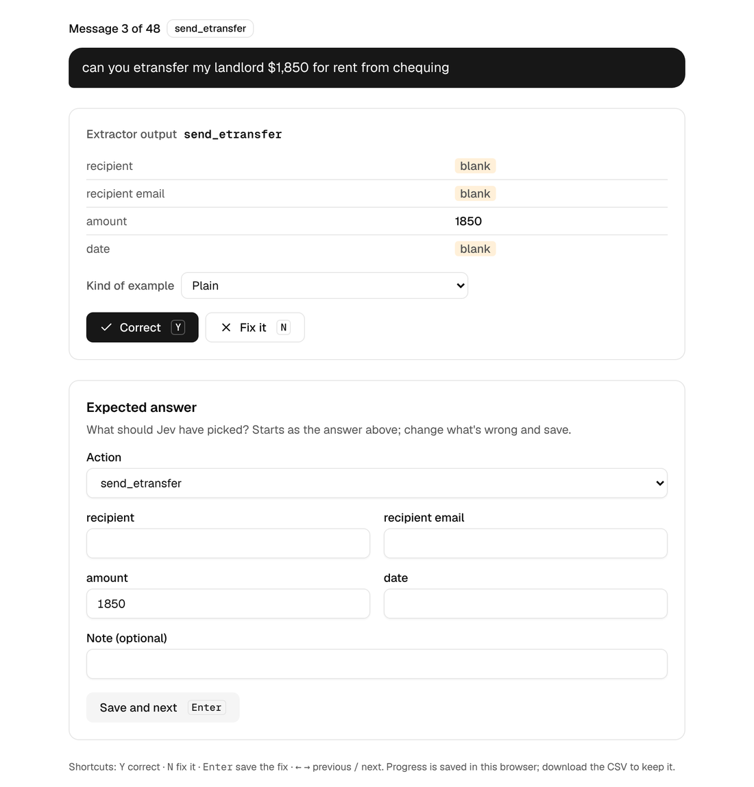

# jev-dynamic-ui

A chat UI that picks a prebuilt banking form and fills it in from what the customer typed. Type "Send $50 to Sam for dinner" and the e-Transfer form opens with the recipient and amount already filled. Anything the message doesn't say stays blank and is highlighted.

## Demo

<a href="docs/demo.mp4"></a>

Click for the full-quality video ([docs/demo.mp4](docs/demo.mp4)).

## Actions

Fourteen actions, one prebuilt form each. Defined in [`src/lib/jev/catalog.ts`](src/lib/jev/catalog.ts), which is the single source of truth for the actions and their fields (schemas).

| Action | What it does | Free-text fields (fine-tuned model) | Choice fields (Jev) |
| --- | --- | --- | --- |
| `add_etransfer_contact` | Save a new e-Transfer recipient | name, email, phone | |
| `send_etransfer` | Send an e-Transfer, now or scheduled | recipient, recipient_email, amount, date | from_account, frequency |
| `request_etransfer` | Ask someone to send you money | from_person, from_email, amount | |
| `cancel_etransfer` | Cancel an unaccepted e-Transfer | recipient, amount | |
| `setup_autodeposit` | Turn on Autodeposit | email, phone | deposit_account |
| `pay_credit_card` | Pay the credit card | amount | payment_option, from_account |
| `pay_bill` | Pay a biller, now or scheduled | payee, amount, date | from_account, frequency |
| `add_payee` | Add a biller | biller, account_number | |
| `transfer_between_accounts` | Move money between your own accounts | amount, date | from_account, to_account, frequency |
| `open_account` | Open a new account | initial_deposit | account_type, from_account |
| `manage_card` | Lock, unlock or replace a card | | card_action, card, reason |
| `view_account` | Show a balance or transactions | | account, view |
| `dispute_transaction` | Dispute a charge | merchant, amount, date | reason |
| `update_contact_info` | Change phone, email or address | new_email, new_phone | contact_type |


| Part | Does | Doesn't |
| --- | --- | --- |
| **Jev** ([TypeSafe AI](https://typesafe.ai) as action decision model, called via API) | Reads the whole message. Picks the action, and picks the answer for each choice field (account, payment option, frequency, card action...) from the catalog's fixed options. | Never writes text; picks action type or multiple choice options. |
| **Fine-tuned extractor** ([LFM2.5-350M](https://docs.liquid.ai/lfm/models/lfm25-350m)) | Copies the free-text values (names, emails, phones, amounts, dates, account numbers) out of the message, or leaves them blank. | Writes text; doesn't pick the action or the choices. |

## Why LFM2.5-350M

1. The main reason: I wanted to fine-tune a model for a specialized task.
2. It's a small model (about 400 MB) that performs well. Its architecture is tuned for edge deployments, so it is free to run locally. That matters because the model runs after each word.
3. It's acceptably quick: ~300ms per response on my MacBook's CPU, <1s on a slower 4 core machine (see [Latency](#latency)).

## How it was built

1. Defined the action space: the 14 user actions and their fields in [`catalog.ts`](src/lib/jev/catalog.ts). This is inspired by typical functions in a banking app.
2. Generated synthetic training data with Opus 5.5.
3. Human-validated a subset of the data - enough to identify key problems and annotate fixes.

   

4. Applied what that review taught to the rest of the data.
5. Fine-tuned the student model (LFM2.5-350M) with supervised fine-tuning (SFT).

Details are in [`docs/sft-dataset.md`](docs/sft-dataset.md) and [`docs/sft-experiments.md`](docs/sft-experiments.md).

## Final experiment result

The extractor model is LFM2.5-350M fine-tuned with LoRA on 1,120 examples. Initial evals showed the model was substituting name for email for instance just because of the order of keys passed into Ollama, so every training row is repeated three times in random key order so it doesn't depend on the order Ollama's JSON schema writes the fields in.

Percentages are the share of messages where the model’s JSON output matched the labelled answer exactly: every field, with no extra or missing fields (key order ignored).

| Measure | Result |
| --- | --- |
| Stress set through the real extractor in Ollama (129 messages, Q8_0, schema on) | **125 / 129** |
| Held-out validation, exact match, any key order (catalog / sorted / reversed) | 98.9 / 98.9 / 99.6 % |
| Held-out test, same three orders | 96.9 / 96.7 / 97.4 % |
| Baseline: base LFM2.5-350M, validation / test | 20.8 % / 24.2 % |

Caveats: 
- about 62 training rows were reviewed by me and the rest were approved/edited by Claude given my annotations.
- the fine tuned model needs real production messages from users. Initial model trainings revealed the dataset was not sufficiently varied for all possible actions and ways of describing them. Additional examples were added to both the training set and validation/test to ensure the model is improving. The test set was never trained on, but it was scored while hill climbing the eval. This result is that compared to the base Liquid FM model, the fine-tuned model behaves better (e.g. doesn't hallucinate values into the structured output when no value is found in the query) but a fair evaluation requires real production data to create an entirely new, non-synthetic dataset.
- full method is in [`docs/sft-experiments.md`](docs/sft-experiments.md).

The stress test is a subset of harder examples. They cover typos (“sned 50 to sam”), accented names, odd amounts (“two grand”, “$1,234,567.89”), several numbers in one message, negation (“don’t send $50”), prompt injection, long polite messages, and other non-banking text.

## Latency

Time per message, from `npm run latency` (60 messages spread over `data/sample-messages.txt`, one at a time, after 2 warm-up messages).

| Step | Messages | Median | 95th percentile | Mean |
| --- | --- | --- | --- | --- |
| Jev (TypeSafe API) | 60 | 0.10 s | 0.15 s | 0.11 s |
| **Fine-tuned LFM2.5-350M (local, cpu)** | 55 | 0.64 s | 0.97 s | 0.56 s |
| Overall (Jev, then extractor) | 60 | 0.71 s | 1.09 s | 0.62 s |

Measured on a 4-core cloud container.

The same run on a MacBook with an M5 CPU:

| Step | Median | 95th percentile | Mean |
| --- | --- | --- | --- |
| Jev (TypeSafe API) | 0.13 s | 0.22 s | 0.14 s |
| **Fine-tuned LFM2.5-350M (local, cpu)** | 0.11 s | 0.19 s | 0.11 s |
| Overall (Jev, then extractor) | 0.24 s | 0.35 s | 0.24 s |

Fast enough for a fluid typing experience.

## Run it

```bash
npm install
cp .env.example .env.local   # add your TYPESAFE_API_KEY
scripts/ollama/use-tuned.sh  # registers the fine-tuned extractor in Ollama (downloads the model from Hugging Face)
npm run dev                  # http://localhost:3000
```

`use-tuned.sh` downloads the fine-tuned model (about 380 MB) from the public [Hugging Face repo](https://huggingface.co/felixglush156/LFM2.5-350M-banking-extractor-GGUF) and registers it in Ollama as `lfm25-350m-sft`.

Needs Node 22+ and [Ollama](https://ollama.com).

Settings, all in `.env.local` (see `.env.example`); only the API key is required:

| Setting | Default | What it does |
| --- | --- | --- |
| `TYPESAFE_API_KEY` | none | Your TypeSafe key for Jev. Server-side only, never prefixed `NEXT_PUBLIC_`. |
| `OLLAMA_URL` | `http://127.0.0.1:11434` | Where Ollama runs. |
| `OLLAMA_MODEL` | `lfm25-350m-sft` | The extractor model in Ollama. Only use a model trained with shuffled key order (see [Final experiment result](#final-experiment-result)). |

### Run voice mode (experimental)

The mic button streams your voice to a local speech server, and the form opens and fills in while you are still talking. It needs Python 3 and a 4-core CPU or better (no GPU); the first start downloads the speech models (about 310 MB, and 460 MB for the optional Whisper second pass).

```bash
# 1. Python packages for both servers (uses uv: https://docs.astral.sh/uv)
uv venv && source .venv/bin/activate
uv pip install -r voice/server/requirements.txt -r voice/server/requirements-whisper.txt

# 2. Live speech server (streaming Zipformer, port 8765)
voice/server/download-model.sh
python voice/server/sherpa_server.py --model-dir voice/models/sherpa-onnx-streaming-zipformer-en-2023-06-26

# 3. Second pass (optional but much more accurate; Whisper small.en by default, port 8000), in another terminal
python voice/server/whisper_server.py            # add --port 8001 if something else uses 8000
```

The second pass serves several models and the chat bar has a **Speech model** dropdown to switch between them without restarting anything: Whisper tiny, base, small, medium; Distil-Whisper small and medium; Qwen3-ASR 0.6B; LFM2.5-Audio. A model downloads and loads the first time you pick it (so that first recording is slower), and the server keeps the last two in memory. Qwen3-ASR and LFM2.5-Audio need a little more setup, and a model that can't run here is left out of the dropdown:

```bash
uv pip install -r voice/server/requirements-qwen.txt         # Qwen3-ASR (the qwen-asr package runs it on PyTorch, about 1 GB)
LFM_AUDIO_URL=http://127.0.0.1:8791 python voice/server/whisper_server.py   # LFM2.5-Audio: point it at a running llama-liquid-audio-server (see voice/bench/run_lfm_audio.py)
```

Sizes, measured on a 4-core CPU after transcribing one clip (the download is the model files in Hugging Face's cache; memory is the server process's peak). The server keeps `--keep-loaded` models in memory at once (2 by default), so budget for the two biggest you switch between, or lower it to 1 on a small machine.

| Model | Download | Memory when loaded |
| --- | --- | --- |
| Live speech server (streaming Zipformer, always on) | about 310 MB | not measured |
| `whisper-tiny.en` | 75 MB | 293 MB |
| `whisper-base.en` | 141 MB | 374 MB |
| `whisper-small.en` (default) | 464 MB | 787 MB |
| `distil-small.en` | 321 MB | 617 MB |
| `whisper-medium.en` | about 1.5 GB (not measured) | not measured |
| `distil-medium.en` | about 0.8 GB (not measured) | not measured |
| `qwen3-asr-0.6b` | 1.8 GB, plus about 1 GB of PyTorch | **6.0 GB** (it runs in 32-bit floats on PyTorch) |
| `lfm2.5-audio` | 1.8 GB (model 1.25 GB, audio encoder 293 MB, vocoder 206 MB, tokenizer 77 MB) | 1.9 GB, in the separate `llama-liquid-audio-server` |

Then add these to `.env.local` and restart `npm run dev`:

```
STT_STREAM_URL=ws://127.0.0.1:8765   # turns on streaming
STT_REFINE=on                        # when you stop, the chosen model re-hears the recording and corrects the form (or pick "Live only" in the dropdown to skip it)
STT_URL=http://127.0.0.1:8000        # where the Whisper server is (match --port)
STT_LIVE_TEXT=off                    # optional: keep the message bar empty while you speak; the form still moves
```

All voice settings. The app reads the first group from `.env.local`; the servers take the second and third as command-line options.

| Setting | Default | What it does |
| --- | --- | --- |
| `STT_STREAM_URL` | none | The live speech server's address. Unset means the mic records first, then transcribes. |
| `STT_REFINE` | off | `on` starts the dropdown on a Whisper-style model instead of **Live only**. |
| `STT_LIVE_TEXT` | on | `off` keeps the message bar empty while you speak. |
| `STT_URL` | `http://127.0.0.1:8000` | The second-pass server, and where the dropdown's model list comes from. |
| `STT_MODEL` | `Systran/faster-whisper-small.en` | The model asked for when the dropdown isn't shown (a server that lists none). |
| `STT_PROVIDER` | `openai-compatible` | The client for the second pass. Only one exists so far. |

| `whisper_server.py` option | Default | What it does |
| --- | --- | --- |
| `--model` or `WHISPER_MODEL` | `whisper-small.en` | The model used when a request names none. One of `whisper-tiny.en`, `whisper-base.en`, `whisper-small.en`, `whisper-medium.en`, `distil-small.en`, `distil-medium.en`, `qwen3-asr-0.6b`, `lfm2.5-audio`. |
| `--keep-loaded` | 2 | How many models stay in memory; the least recently used is dropped. |
| `--threads` | 4 | CPU threads per model. |
| `--host`, `--port` | `127.0.0.1`, 8000 | Where it listens. |
| `LFM_AUDIO_URL` | none | The `llama-liquid-audio-server` that LFM2.5-Audio runs on. Without it that model is hidden. |

| `sherpa_server.py` option | Default | What it does |
| --- | --- | --- |
| `--model-dir` | required | The streaming Zipformer model folder. |
| `--host`, `--port` | `127.0.0.1`, 8765 | Where it listens. |
| `--threads`, `--workers` | 4, 2 | CPU threads per model, and how many connections decode at once. |
| `--hotwords-file`, `--hotwords-score` | none, 1.5 | Words to favour (prepare them with `voice/server/prepare_hotwords.py`) and how strongly. |

Allow the microphone in the browser (`localhost` is allowed), press the mic and say "send fifty dollars to Sam for dinner". The e-Transfer form should open before you finish the sentence. Without `STT_REFINE=on` only the streaming server is used, which is faster to start but makes more mistakes on real voices. Optional hotwords for the streaming server, and how it all fits together, are in [AGENTS.md](AGENTS.md#voice-mode-experimental).
